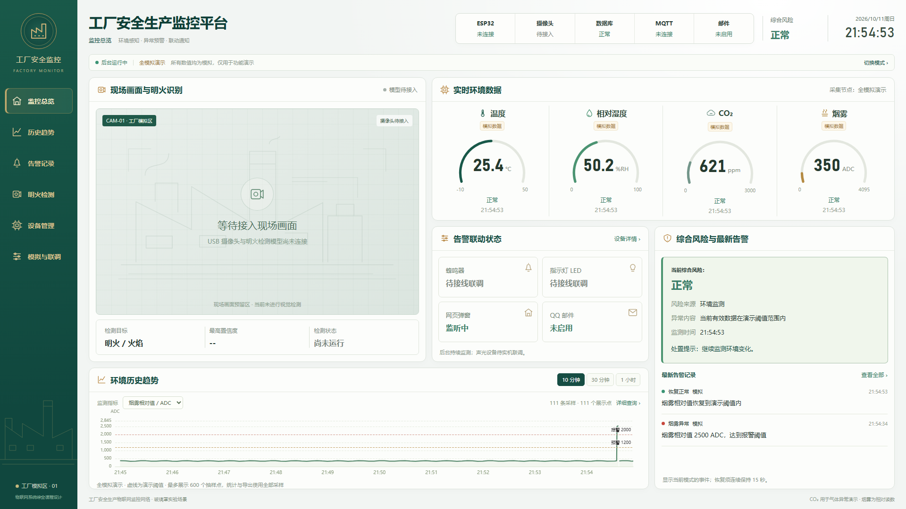
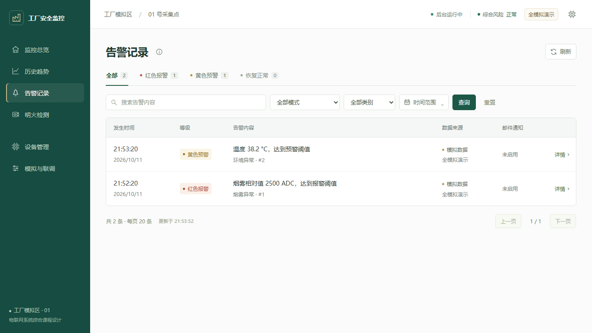
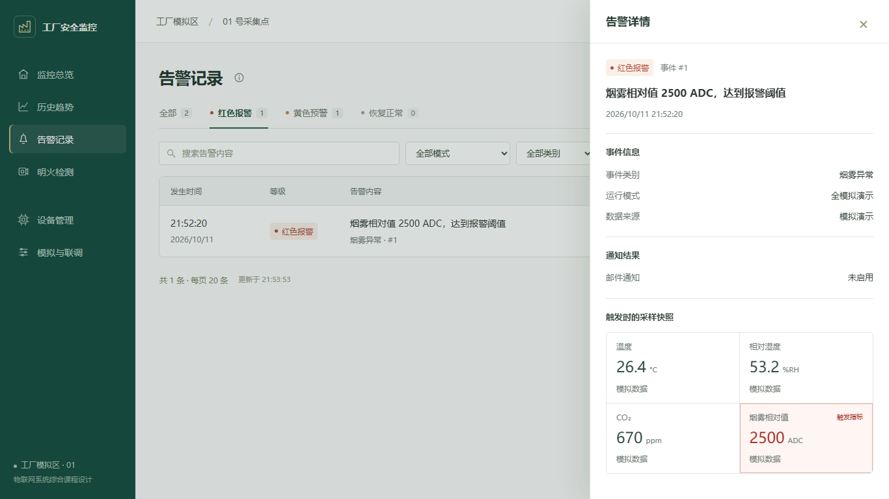
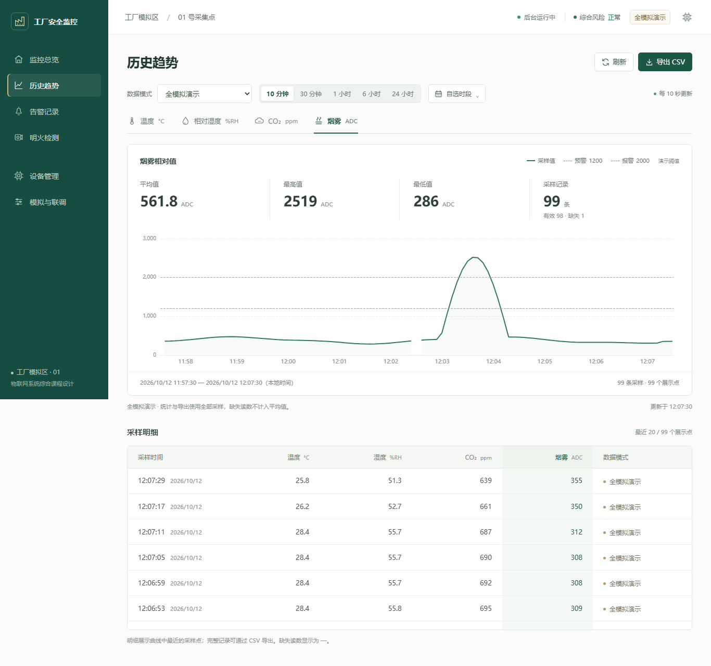
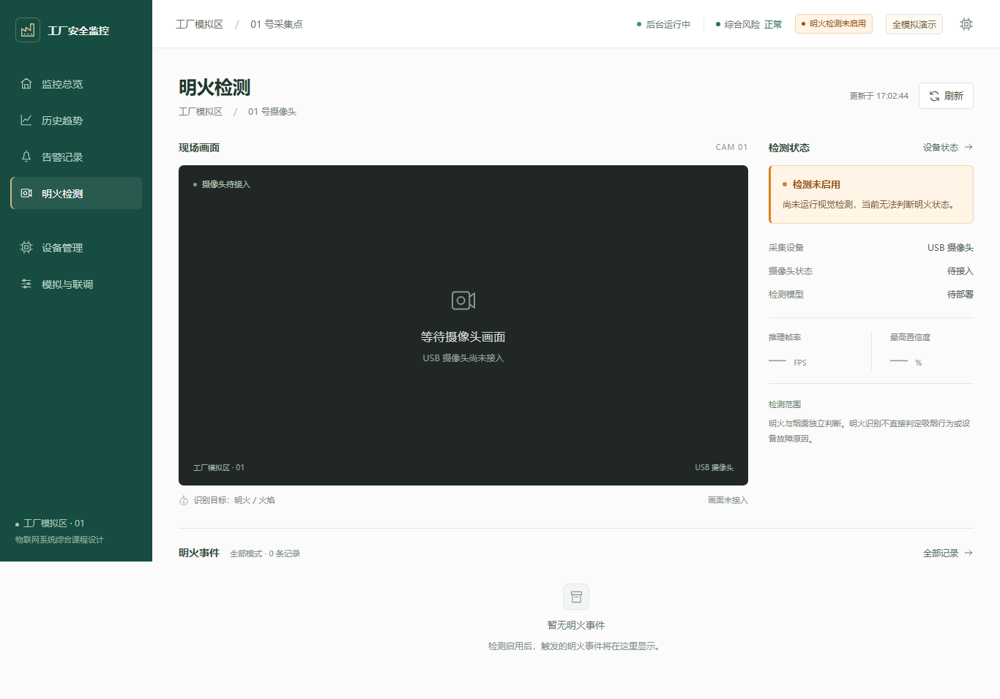
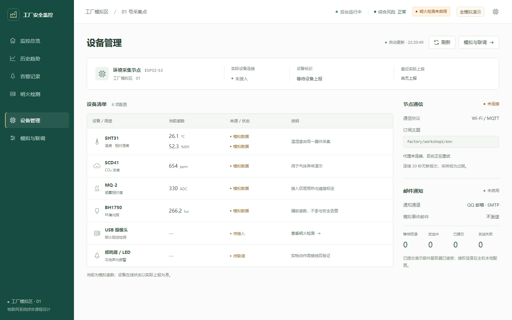
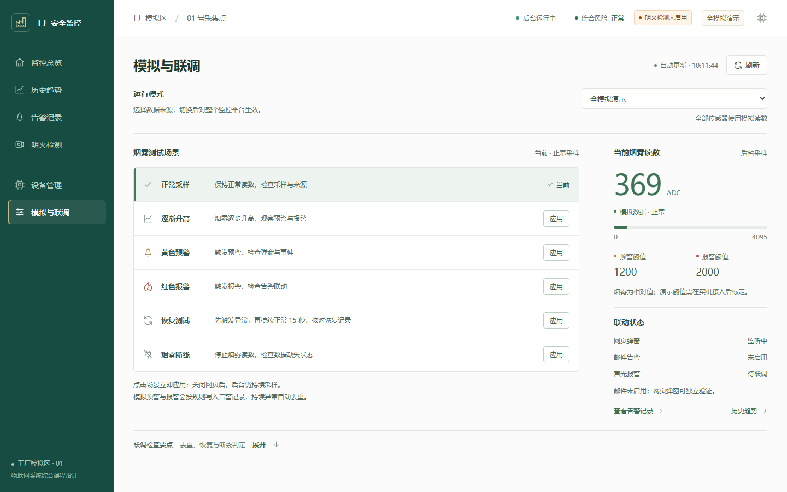
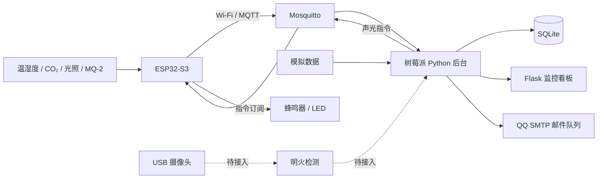

# 面向工厂的安全生产物联网监控网络

《物联网系统综合课程设计》项目。以小型玻璃罩模拟工厂环境，计划通过 ESP32-S3 采集环境数据，经 Wi-Fi / MQTT 发送至树莓派，实现实时监测、异常告警、历史查询和远程通知。

**当前版本：v0.1.0 — 监控软件与模拟验证基线。** 已完成看板、数据存储和告警流程的软件实现；真实硬件、QQ 邮件接收与明火视觉检测仍需联调。完整进度见 [任务书核对](REQUIREMENTS_CHECK.md) 和 [开发计划](DEVELOPMENT_PLAN.md)。

`main` 分支已完成六页界面整理，以及四传感器采集、本地声光与 MQTT 平台控制的 [ESP32 整合固件](firmware/README.md)，尚未另打发布标签。用户已完成分项串口采样和声光开关测试；整合固件上传、树莓派部署与完整联调仍待完成，见 [部署与验收步骤](docs/HARDWARE_INTEGRATION.md)。页面改动见 [历史页](docs/HISTORY_UI.md)、[明火页](docs/VISION_UI.md)、[设备页](docs/DEVICES_UI.md) 与 [模拟联调页](docs/SIMULATION_UI.md)。

## 界面预览

以下截图来自隔离的模拟测试数据，不代表实机测量或摄像头识别结果。



<details>
<summary>告警记录与事件详情</summary>





</details>

<details>
<summary>历史趋势页（当前开发版）</summary>



</details>

<details>
<summary>明火检测页（当前开发版）</summary>



</details>

<details>
<summary>设备管理页（当前开发版）</summary>



</details>

<details>
<summary>模拟与联调页（当前开发版）</summary>



</details>

## 功能与进度

| 模块 | 当前能力 | 状态 |
| --- | --- | --- |
| 实时监控 | 温度、湿度、CO₂、烟雾相对值；光照辅助显示；数据来源与有效性标记 | 软件与模拟流程已验证 |
| 历史趋势 | SQLite 存储、按模式与时段查询、统计、CSV 导出 | 已实现 |
| 告警记录 | 分指标阈值、持续异常去重、等级升级、恢复确认、筛选分页与快照抽屉 | 已实现 |
| 通知 | 网页弹窗；QQ SMTP 持久化队列与失败重试 | 网页已验证；邮件真实接收待验证 |
| 模拟与联调 | 三种数据模式、六种烟雾场景、读数与联动状态；操作反馈、失败后核对模式、断线恢复 | 页面已整理；软件与模拟流程已验证 |
| 设备接入 | 独立 ESP32 固件、MQTT 校验与可选登录、树莓派启动脚本；器件清单与通信状态 | 代码已准备；烧录、代理和硬件联调待完成 |
| 声光报警 | 本地阈值判断、平台指令、设备反馈；断网时保留本地告警 | 独立开关测试成功；完整联动待实测 |
| 明火检测 | 单摄像头画面预留区、检测状态、按视觉来源读取已有事件 | 页面已整理；摄像头、模型与截图待接入，为额外功能 |

无效、缺失或过期的数据不会被当成零值或正常状态；未接入的摄像头和执行器明确显示待接入。关闭网页后，采样与告警仍由 Python 后台运行；关闭后台进程则停止监测。

## 系统结构

技术栈：Python / Flask、SQLite、paho-mqtt、原生 HTML / CSS / JavaScript、Apache ECharts。



树莓派部署及图中的硬件链路尚未实机验收。目前支持一个模拟区域、一个采集节点；多节点管理不在首版范围内。

## 硬件方案

| 硬件 | 用途 | 本项目接入进度 |
| --- | --- | --- |
| Raspberry Pi 5 Model B，8GB | 后台、数据库、MQTT 代理与后续视觉推理 | 待部署验证 |
| ESP32-S3 开发板 | 读取传感器、上报数据和本地声光报警 | 整合固件编译通过，待上传与联网验收 |
| SHT31 | 温度与相对湿度 | 串口有效读数已见，MQTT 待联调 |
| Sensirion SCD41 | CO₂ 气体异常演示 | 已有有效串口读数，MQTT 待联调 |
| BH1750 | 辅助光照读数 | 已有有效串口读数，MQTT 待联调 |
| MQ-2 模块 | 烟雾相对变化与阈值告警 | 已有 ADC 读数；烟雾响应与阈值待验证，整合联调待完成 |
| 蜂鸣器、LED | 本地声光报警 | 用户确认 GPIO5 / GPIO6 同步开关成功，告警联动待验证 |
| USB 摄像头 | 后续明火视觉检测 | 已有器件，模型尚未接入 |

CO₂ 用于气体异常的替代演示，不代表测量有毒气体。MQ-2 采用 ADC 相对读数，不能直接标为烟雾 ppm；演示阈值需在实测后调整。这是课程原型，不能作为经过认证的工业安全系统。

2026-10-15 已准备 [完整固件与上传说明](firmware/README.md)。[传感器诊断](firmware/sensor_check/README.md) 和 [声光开关测试](firmware/alarm_check/README.md) 保留用于分项排查；分项动作成功不等于完整网络联调通过。

## 快速开始

无硬件也可使用 `demo` 模式运行。首版在 Windows / Python 3.12.7 上验证；树莓派实机验证待完成。

### Windows PowerShell

```powershell
git clone https://github.com/bridge-a/factory-safety-iot-monitoring.git
cd factory-safety-iot-monitoring
python -m venv .venv
.\.venv\Scripts\python.exe -m pip install -r requirements-dashboard.txt
$env:FACTORY_MODE = 'demo'
.\.venv\Scripts\python.exe dashboard.py
```

打开 [本地监控看板](http://127.0.0.1:5001)。按 `Ctrl+C` 停止服务。环境安装后也可使用 `./start_dashboard.ps1 -Mode demo` 启动。

### Linux / 树莓派

```bash
git clone https://github.com/bridge-a/factory-safety-iot-monitoring.git
cd factory-safety-iot-monitoring
python3 -m venv .venv
.venv/bin/python -m pip install -r requirements-dashboard.txt
FACTORY_MODE=demo .venv/bin/python dashboard.py
```

需要局域网访问时设置 `FACTORY_WEB_HOST=0.0.0.0`，访问主机地址的 `5001` 端口。当前没有账号认证，开发服务仅用于可信局域网联调，不直接开放到公网。

只运行一个 `dashboard.py` 实例，后台已统一管理 MQTT、采样、存储和通知。不要另起 `mqtt_ingest.py` 或 `alert_rule.py`。Windows 虚拟环境不能复制到树莓派使用。

需要保留现有文物系统并接入真实传感器时，按 [树莓派独立部署步骤](docs/HARDWARE_INTEGRATION.md) 使用 `deploy/raspberry-pi/` 中的准备、启动与服务安装脚本。完整采集选择 `live`；需要模拟烟雾测试声光时临时切 `hybrid`。

## 运行模式与配置

| 模式 | 温湿度、CO₂ 等环境参数 | 烟雾 | 用途 |
| --- | --- | --- | --- |
| `demo` | 模拟数据 | 模拟数据 | 无硬件检查页面与告警流程 |
| `hybrid`（默认） | ESP32 上报，未收到则为空 | 模拟数据 | 真实环境与模拟烟雾联调 |
| `live` | ESP32 上报 | ESP32 上报 | 完整硬件采集与联调 |

在“模拟与联调”页面切换模式会影响同一后台的所有页面。新固件在线时，模拟异常也会驱动真实 LED 和蜂鸣器；本地异常优先，不会被平台正常状态压掉。重新启动后使用 `FACTORY_MODE`，不会自动恢复上次页面选择。

常用配置：`FACTORY_MQTT_HOST`、`FACTORY_MQTT_PORT`、`FACTORY_WEB_HOST`、`FACTORY_WEB_PORT`、`FACTORY_DATA_DIR`。MQTT 报文、演示阈值和 QQ 邮件设置见 [接入与配置说明](docs/CONFIGURATION.md)。

邮件默认关闭。复制 `mail.ini.example` 为 `mail.ini` 后在本机填写 SMTP 授权码；使用 `python check_mail.py` 检查配置。模拟邮件需额外开启 `allow_demo`。`mail.ini` 已被 Git 忽略，请勿提交授权码。

## 项目目录

```text
factory-safety-iot-monitoring/
├── dashboard.py              # Flask 入口与 API
├── runtime.py                # 后台运行、模式切换与模拟采样
├── settings.py               # 环境变量与路径配置
├── mqtt_ingest.py            # MQTT 数据接收和校验
├── alert_rule.py             # 指标阈值
├── environment_store.py      # 历史数据存储与查询
├── notification_core.py      # 告警状态、事件、邮件队列
├── check_mail.py             # 本地邮件配置检查
├── templates/                # 六个页面与公共组件
├── static/                   # 样式、脚本与本地 ECharts
├── tests/                    # 后端与浏览器验证
├── firmware/                 # 独立 ESP32-S3 草图及无凭据配置示例
├── deploy/raspberry-pi/       # Linux 环境、启动和 systemd 安装脚本
├── docs/                     # 接入说明、验证记录与展示截图
├── mail.ini.example          # 不含真实凭据的邮件配置示例
├── requirements-dashboard.txt
└── requirements-dev.txt
```

运行后生成 `data/environment.sqlite3` 和 `data/alerts.sqlite3`；数据库、日志、虚拟环境和 `artifacts/` 测试输出均不上传。原文物项目与本仓库独立。

## 验证与后续安排

后端测试：

```powershell
.\.venv\Scripts\python.exe -m pip install -r requirements-dev.txt
New-Item -ItemType Directory -Force .test-tmp | Out-Null
$qaTempPath = Join-Path '.test-tmp' ([guid]::NewGuid().ToString('N'))
.\.venv\Scripts\python.exe -m pytest -q --basetemp=$qaTempPath
```

浏览器验证与首版结果见 [验证记录](docs/VALIDATION.md)。测试使用隔离数据库和模拟邮件发送函数，不代表实机或真实邮件投递通过。

本轮界面整理完成，当前推进树莓派独立部署与现有传感器 MQTT 上报。固件和部署文件已准备，等待实机连接后验证；随后完成 QQ 邮件真实接收，再接入 MQ-2 和本地声光报警，记录稳定性与传感器布置测试，整理演示和课设报告。主线连通后推进明火检测模型；告警高级功能暂缓。

- [任务书要求与实现核对](REQUIREMENTS_CHECK.md)
- [开发与验收安排](DEVELOPMENT_PLAN.md)
- [版本更新日志](CHANGELOG.md)
- [提交与版本维护约定](CONTRIBUTING.md)

## 第三方组件与许可

ECharts 随仓库附带其许可证与 NOTICE，详见 [第三方说明](THIRD_PARTY_NOTICES.md)。本项目尚未指定项目级开源许可证；公开展示不等于授予任意使用或再分发的许可。
